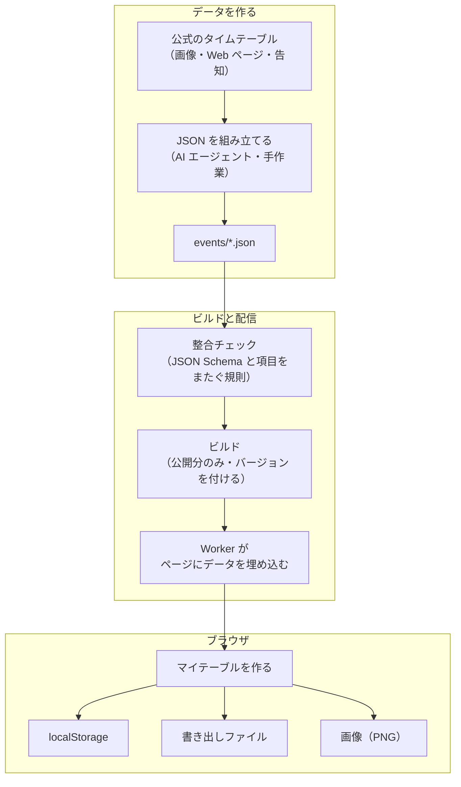

# 仕様

マイテーブルの設計と、イベントデータの扱いをまとめる。フォークして自分のイベントで使えるよう、データの形式（スキーマ）もここで公開する。

## 概要と設計方針

フェスやカンファレンスのタイムテーブルから、見たい枠を選んで自分だけのマイテーブルを作る非公式ツール。個人用・内向きのツールとして、シンプルさを優先する。このリポジトリはリファレンス実装で、ほかのイベントで使うときは、テンプレートやフォークで自分のサイトを作ることを想定している（[README](../README.md#このリポジトリについて)）。

- **非公式**: イベントの主催者・出演者とは関係がない。最新・正確な情報は各イベントの公式で確認してもらう
- **静的なデータ**: タイムテーブルは JSON ファイルとしてリポジトリに置き、ビルド時に取り込む。管理画面やデータベースは持たない。データの更新は Git 経由だけで行う
- **ログインなし**: 利用者の選択はブラウザの localStorage にだけ保存し、サーバーには送らない。控えはファイルへの書き出しと画像で取る
- **事実だけを持つ**: 公式の情報から、時刻・ステージ・出演者名・タイトルなどの事実だけを取り込む。概要文や画像は持たない
- **検索エンジンに載せない**: 全ページに `noindex` を付ける

## データの流れ

公式のタイムテーブルを、AI エージェントや手作業でイベントデータ（JSON）に組み立てるところから始まる。当日の変更（押し・時刻変更など）も、同じ流れでデータを直して反映する。



## イベントデータ

### 置き場所とチェック

```
events/<event-id>.json        1イベント1ファイル。ファイル名はイベントID と揃える
schema/v1/event.ts            スキーマの定義（Zod）。型・チェック・JSON Schema はここから作る
schema/v1/event.schema.json   JSON Schema。event.ts から `pnpm schema` で生成する
```

- JSON Schema は https://mt.whyk.dev/schema/v1/event.schema.json でも配信している。データの先頭に `"$schema": "https://mt.whyk.dev/schema/v1/event.schema.json"` と書くと、エディタで補完とチェックが効く。AI エージェントにデータを組み立ててもらうときも、このスキーマを渡す
- `pnpm validate` で整合チェックを手元で実行できる（`pnpm validate path/to/event.json` でファイルを指定）。ビルドのときにも同じチェックが走り、エラーがあればビルドを止める
- `visibility: "private"` のイベントはビルドに含めない。公開をやめたイベントもデータは残しておける
- ビルド時に、元の JSON の SHA-256 の先頭12桁をデータのバージョンとして付ける。利用者側はこのバージョンでデータの更新に気づく

### スキーマ（v1）

イベント → 日 → ステージ → 枠 の4階層。

- 時刻はすべてイベントのタイムゾーンでの `HH:MM`。日をまたぐ深夜帯は `24:30` のように24時以降で書く
- 任意の項目は、省略するか `null` にする
- スキーマにない項目はエラーにする（綴りの間違いに気づけるように）

#### イベント（ファイルの最上位）

| 項目                    | 必須 | 内容                                                      |
| ----------------------- | ---- | --------------------------------------------------------- |
| `$schema`               |      | スキーマの URL（エディタ用）                              |
| `schema_version`        | ○    | `"1"`                                                     |
| `id`                    | ○    | 英小文字・数字・ハイフン。URL（`/e/<id>`）になる          |
| `visibility`            | ○    | `public` はサイトに含める。`private` はビルドから除外する |
| `event.name`            | ○    | イベント名                                                |
| `event.timezone`        | ○    | IANA タイムゾーン（例: `Asia/Tokyo`）                     |
| `event.venue`           |      | 会場                                                      |
| `event.official_url`    |      | 公式サイト                                                |
| `event.sources`         |      | 取り込み元（公式タイムテーブル画像、公式告知など）の説明  |
| `event.notice`          |      | 公式の注意書き                                            |
| `event.detail_url_base` |      | 枠の `detail` を相対パスで書くときの基準 URL              |
| `tag_definitions`       |      | タグのキーと表示名。例: `{ "no_photo": "撮影禁止" }`      |
| `days`                  | ○    | 1日以上                                                   |

#### 日（`days` の要素）

| 項目         | 必須 | 内容                                             |
| ------------ | ---- | ------------------------------------------------ |
| `date`       | ○    | `YYYY-MM-DD`                                     |
| `label`      |      | 表示名（例: `DAY1`）                             |
| `end_time`   |      | 終演時刻                                         |
| `day_events` |      | 開場・休憩・懇親会など、選択の対象にしない時間帯 |
| `stages`     | ○    | 1つ以上                                          |

`day_events` の要素は `start`（必須）、`end`、`title`（必須）、`kind`（必須。`doors` `break` `ceremony` `party` `setup` `close` `other`）、`stages`（対象のステージID。省略すると全ステージ共通）。

#### ステージ（`stages` の要素）

| 項目      | 必須 | 内容                                                |
| --------- | ---- | --------------------------------------------------- |
| `id`      | ○    | 日の中で一意                                        |
| `name`    | ○    | 表示名                                              |
| `color`   |      | 表示色（CSS の色。OKLCH で書く）                    |
| `hashtag` |      | ハッシュタグ                                        |
| `closed`  |      | ステージが閉まっている時間帯 `[{ "start", "end" }]` |
| `slots`   | ○    | 枠の配列                                            |

#### 枠（`slots` の要素）

| 項目            | 必須 | 内容                                                                                                                          |
| --------------- | ---- | ----------------------------------------------------------------------------------------------------------------------------- |
| `id`            | ○    | イベント内で一意（`items` の `id` とも重複しない）。利用者の選択はこの ID で保存される                                        |
| `start` / `end` | ○    | 開始・終了時刻                                                                                                                |
| `end_source`    | ○    | 終了時刻の根拠。`explicit` 公式に記載 / `next_slot` 次の枠と連続 / `inferred` 推定 / `day_end` 終演時刻から                   |
| `title`         | ○    | 枠の名前。`items` がある枠だけ `null` にできる。音楽系は出演者名、カンファレンスはトークタイトル                              |
| `category`      | ○    | `performance` `talk` `keynote` `workshop` `ceremony` `other`                                                                  |
| `kind_label`    |      | 元の表記（`LIVE` `DJ` `10分セッション` など）                                                                                 |
| `speakers`      |      | 出演者・登壇者                                                                                                                |
| `note`          |      | 補足（ゲスト、押しの情報など）                                                                                                |
| `subtitle`      |      | 副題                                                                                                                          |
| `lang`          |      | 言語（`ja` `en` など）                                                                                                        |
| `tags`          |      | `tag_definitions` に定義したキー                                                                                              |
| `simulcast_in`  |      | 同時中継先のステージID                                                                                                        |
| `detail`        |      | 詳細ページの URL（または `detail_url_base` からの相対パス）                                                                   |
| `external_url`  |      | 外部申込などの URL                                                                                                            |
| `items`         |      | 1つの枠に、個別の開始時刻なしで複数のトークが入る場合のトーク一覧。要素は `id`（必須）、`title`（必須）、`speakers`、`detail` |

### 項目が表示にどう効くか

イベントページ（`/e/<id>`）は、1日分の枠を開始時刻順に並べて出す。同じ開始時刻の枠は、ステージの並び順に並べる。画面の切り替えや当日の表示などの動きは「[画面の動き](#画面の動き)」を参照。

| 項目                                  | 表示                                                                                                                         |
| ------------------------------------- | ---------------------------------------------------------------------------------------------------------------------------- |
| `event.name` / `event.venue`          | ページの見出しと、その下の会場                                                                                               |
| `event.official_url`                  | ページ下部の「公式サイト」のリンク（`http://`・`https://` で始まるものだけ）                                                 |
| `event.sources` / `event.notice`      | ページ下部に「取り込み元」「公式の注意書き」として出す                                                                       |
| 日の `label` / `date`                 | 表示している日（例: `DAY1 · 10/31(土)`）。複数日のイベントでは日付のチップにする                                             |
| 日の `day_events`                     | 開始時刻の位置に、枠とは別の行で出す。`stages` があればそのステージ名、なければ「全体」。`end` があれば終了時刻も出す        |
| ステージの並び順                      | 絞り込みのチップの順と、同じ開始時刻の枠の順                                                                                 |
| ステージの `name` / `color`           | チップと枠に出す。`color` がなければ、ステージの並び順で既定の色を割り当てる                                                 |
| 枠の `start` / `end` / `end_source`   | `end_source` が `explicit` のときだけ「開始–終了」、それ以外は開始だけを出す（推定の終了時刻を公式の時刻と誤認されないため） |
| 枠の `title` / `kind_label`           | 枠の名前と種別。`title` が `null` の枠（ブロック）は `kind_label` を見出しにする                                             |
| 枠の `subtitle` / `note` / `speakers` | 枠の名前の下に並べる                                                                                                         |
| 枠の `tags`                           | `tag_definitions` の表示名で出す                                                                                             |
| 枠の `items`                          | ブロックとして、トークを順番に並べる。個別の開始時刻はないので、時刻は枠のものだけを出す                                     |
| 枠の `simulcast_in`                   | 元の枠に「同時中継: ステージ名」と出す。横並び表示では、中継先のステージの列にも「中継」として出す                           |
| ステージの `closed`                   | 横並び表示で、そのステージの列の時間帯を斜線で塗りつぶし「クローズ」と出す                                                   |

利用者が選べる単位は、枠そのものか、ブロック（`items` のある枠）の中のトーク1本。ブロックの枠自体は選べる単位にしない。ブロックのトークには「1/3」のように順番を出す。

同時中継（`simulcast_in`）の枠は、中継先のステージに出ていても枠は1つで、どちらを選んでも同じ単位が選ばれる。中継先のステージで絞り込んだときにも出す。

24時以降の時刻（`24:30` など）は、データと同じ表記のまま出し、その日の最後に並べる。

### 整合チェック

JSON Schema で形を確かめたあと、項目をまたぐ規則を確かめる。

エラー（ビルドを止める）:

- スキーマに合わない（必須項目の欠落、形式・型・列挙値の誤り、スキーマにない項目）
- ファイル名がイベントID と違う
- 枠と `items` を通して `id` が重複している
- 日付、または同じ日のステージID が重複している
- 終了時刻が開始時刻以前
- `items` がない枠の `title` が `null`
- 存在しないステージID、定義していないタグを参照している
- 同じステージで時間が重なる。`closed` の時間帯と、`simulcast_in` で中継される枠もそのステージを使っているものとして扱う

警告（ビルドは続ける）:

- 枠と、休憩などの `day_events`（開場を除く）の時間が重なっている。元データ自体の矛盾なので自動では直さず、公式の表記のまま残す
- `end_source` が `next_slot` の枠の終了時刻が、同じステージで次に始まる枠の開始時刻と違う。または次の枠がない。`simulcast_in` で中継される枠も、中継先のステージの枠として扱う。休憩などの `day_events` とは比べない

### データ作成の指針

- 公式の情報から、時刻・ステージ・出演者名・タイトルなどの事実だけを取り込む。トークの概要文、登壇者のアイコン、アーティスト写真、公式画像そのものは取り込まない
- 枠の `id` は、一度公開したら時刻が変わっても変えない。利用者のマイテーブルはこの ID で保存されている。公式の ID があればそれを使い、なければ `d1-main-1230`（日・ステージ・開始時刻）のように振る
- 公式に書かれていない終了時刻は、根拠に合わせて `explicit` 以外にする。推定の終了時刻は画面に出さない
- 枠を後ろにずらしたら、その直前にある、動かしていない `next_slot` の枠を見直す。公式が終了時刻を書いていなければ、終了時刻はそのままにして `inferred` に変える

当日の変更は、データを直して同じ流れで反映する。

| 変更                                     | 書き方                                                                                                                                                                 |
| ---------------------------------------- | ---------------------------------------------------------------------------------------------------------------------------------------------------------------------- |
| 押し（遅延）                             | まだ始まっていない枠の時刻をずらし、`note` に根拠を残す（例: `20分押し（公式告知 11/01 18:31）`）。`id` は変えない                                                     |
| 時刻・ステージの変更                     | 時刻やステージを直す。`id` は変えない                                                                                                                                  |
| 枠の追加                                 | 新しい `id` の枠を足す                                                                                                                                                 |
| リトライ（機材トラブルなどでのやり直し） | 元の枠は残し、やり直しの枠を新しい `id` で足す                                                                                                                         |
| キャンセル                               | 枠を削除する。後ろの枠が繰り上がるときは、時刻の変更として直す（枠を残すと繰り上がった枠と時間が重なる）。選んでいた利用者には、次に開いたときに外れた件数が知らされる |

## 画面の動き

イベントページ（`/e/<id>`）の動き。データの項目ごとの出し方は「[項目が表示にどう効くか](#項目が表示にどう効くか)」を参照。

### リストと横並び

画面の幅が 720px 以上のときは、ステージを列、時間を縦軸にした横並び表示にする。スマホ（狭い画面）とマイテーブルはリストのまま。

- 表示する時間の範囲は、その日の枠と `day_events` が入る範囲を30分単位に丸める。目盛りは30分ごとで、正時を強調する
- 枠の高さは時間に比例する（1分あたり 3.4px）。短い枠でも最低限の高さを確保する
- `stages` のない `day_events`（全ステージ共通）は列をまたぐ帯、`stages` のあるものはそのステージの列の中に出す
- ステージで絞り込むと、そのステージの列だけになる

### 日付の切り替え

複数日のイベントは、日付のチップ（例: `10/31(土)`）で表示する日を切り替える。

- URL の `?day=YYYY-MM-DD` で日を指定できる。切り替えると URL も変わり、ブラウザの「戻る」「進む」に追従する。何日目かの番号ではなく日付で指定する
- 開いたときの日は、`?day=` の日 → 今日が開催日ならその日 → 初日 の順に選ぶ。存在しない日付が指定されたときも同じ規則で選ぶ
- 「今日」はイベントのタイムゾーン（`event.timezone`）で判定する
- 日付のチップには、その日に選んでいる件数を出す

### 選択とマイテーブル

枠（ブロックはトーク1本ずつ）をタップすると選べる。表示は「タイムテーブル」と「マイテーブル」を切り替えられ、マイテーブルには選んだ単位だけを時刻順に並べる。時間が重なる単位も選べる。件数は、表示している日の分を出す。

### 当日の表示

開催当日は、いまどの枠が進行中かを出す。

- 時刻はすべてイベントのタイムゾーン（`event.timezone`）で判定する。閲覧者の端末のタイムゾーンには左右されない
- 進行中の枠は、枠線を強調して「進行中」と出す。1分ごとに更新する。ブロックの中のトークには個別の時刻がないので、枠の時間で判定する
- 終了時刻が推定の枠も、進行中の判定には推定の終了時刻を使う（画面には出さない）
- 「いまへ」ボタンで、現在時刻の位置までスクロールする。いまがその日の表示範囲に入っているときだけ出す
- 横並び表示には、現在時刻の線を引く
- 日をまたぐ枠（`24:30` など）が終わるまでは、翌日の未明も前の日の続きとして扱う。この間に開くと、前の日を表示する

### 時間の重なり

同じ日に選んだ単位どうしの時間が重なっているときは、タイムテーブルとマイテーブルの両方で、重なっている相手の名前を添えて知らせる。

- 開始が同じか、先に始まる側の終了時刻が公式に書いてある（`end_source` が `explicit`）ときは「時間が重なっています」
- 先に始まる側の終了時刻が推定のときは「重なっている可能性があります」
- 同じブロックの中のトークどうしは、順に行われるので重なりとみなさない

## 利用者側のデータ形式

利用者の選択は、ブラウザの localStorage にだけ保存する。サーバーには送らない。

- キー: `my-table:v1:<イベントID>`（イベントごとに1つ。`v1` は保存する形の版）
- 値: 次の JSON

```json
{
  "version": "3f9a1c0b7e2d",
  "selected": ["d1-main-1230", "talk-2"],
  "updatedAt": "2026-11-01T03:00:00.000Z"
}
```

| 項目        | 内容                                                                            |
| ----------- | ------------------------------------------------------------------------------- |
| `version`   | 保存したときのイベントデータのバージョン（ビルド時に付けたもの）                |
| `selected`  | 選んだ単位の ID。枠の `id` か、ブロックの中のトーク（`items`）の `id`。選んだ順 |
| `updatedAt` | 保存した日時（ISO 8601、UTC）                                                   |

- 選ぶ・外すのたびに保存する
- 保存がない・壊れている・形が違うときは、何も選んでいない状態から始める
- タイムテーブルのデータが更新されても、選択は初期化しない。ページを開いたときに保存してある選択を今のデータに合わせ、なくなった単位（存在しない ID）だけを外す。重複も除く
- 外れた単位があるときだけ「タイムテーブルが更新され、選んでいたN件が外れました。」と出す
- 時刻やステージが変わっただけの枠は `id` が同じなので、選択はそのまま残る
- データのバージョンが変わっていたとき・外れた単位があったときは、合わせた結果を今のバージョンで保存し直す
- localStorage が使えない（プライベートブラウズなど）ときも画面は動く。保存できなかったときは、その旨を画面に出す

### 書き出しファイル

マイテーブルは、ファイルに書き出して、別の端末やブラウザで読み込める。ログインがない代わりの、控えと移行の手段。選択は全日分をまとめて書き出す。ファイル名は `my-table-<イベントID>.json`。

```json
{
  "format": "my-table",
  "formatVersion": 1,
  "eventId": "example-fes-2026",
  "eventName": "Example Fes 2026",
  "version": "3f9a1c0b7e2d",
  "selected": ["d1-main-1230", "talk-2"],
  "exportedAt": "2026-11-01T03:00:00.000Z"
}
```

| 項目            | 内容                                                         |
| --------------- | ------------------------------------------------------------ |
| `format`        | `"my-table"`。このツールの書き出しファイルであることの目印   |
| `formatVersion` | ファイルの形の版。`1`                                        |
| `eventId`       | イベントID                                                   |
| `eventName`     | イベント名。別のイベントのファイルを選んだときの知らせに使う |
| `version`       | 書き出したときのイベントデータのバージョン                   |
| `selected`      | 選んだ単位の ID                                              |
| `exportedAt`    | 書き出した日時（ISO 8601、UTC）                              |

読み込み:

- 形が違うファイル・`formatVersion` が違うファイル・別のイベントのファイルは、その旨を出して何もしない
- 読み込んだ選択は今のデータに合わせる。なくなった単位は外し、外れた件数を知らせる
- 既にマイテーブルがあるときは、確認してから上書きする。既存の選択とは混ぜない

マイテーブルの「すべて解除」は、確認してから全日分の選択を外す。

### 画像（PNG）

表示している日のマイテーブルを、1枚の画像にして保存できる。当日、電波が悪くても見られる控え用。ブラウザの中（canvas）で作り、サーバーには送らない。ファイル名は `my-table-<イベントID>-<日付>.png`。

- イベント名・日付・件数と、選んだ単位ごとの時刻・ステージ・タイトル・出演者を出す
- 終了時刻は `end_source` が `explicit` のときだけ、開始時刻の下に出す
- 長いタイトルは2行まで折り返し、収まらなければ省略記号で詰める。英数字の連続は単語の途中で折り返さない
- タグと、時間の重なり（相手の名前つき）も出す
- 色は、画面と同じテーマ（OS のダーク・ライト）とステージ色を使う。OKLCH を解釈できない古いブラウザ（2023年春より前の版）は、画面も含めて対象にしない
- 作った画像はプレビューで確かめてから、ダウンロードするか、スマホでは長押しで写真に保存する
