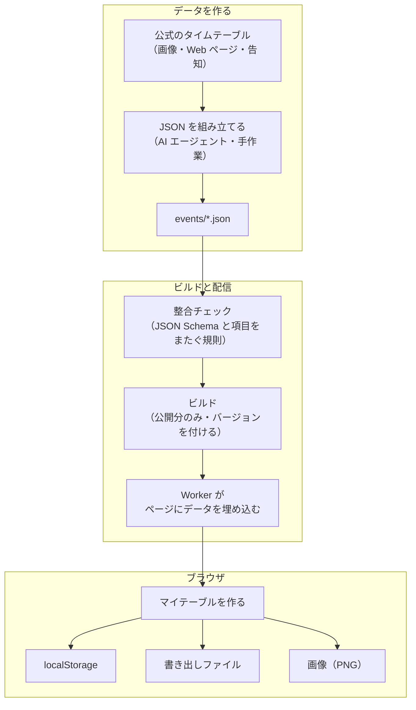

# 仕様

マイテーブルの設計と、イベントデータの扱いをまとめる。フォークして自分のイベントで使えるよう、データの形式（スキーマ）もここで公開する。

## 概要と設計方針

フェスやカンファレンスのタイムテーブルから、見たい枠を選んで自分だけのマイテーブルを作る非公式ツール。個人用・内向きのツールとして、シンプルさを優先する。

- **非公式**: イベントの主催者・出演者とは関係がない。最新・正確な情報は各イベントの公式で確認してもらう
- **静的なデータ**: タイムテーブルは JSON ファイルとしてリポジトリに置き、ビルド時に取り込む。管理画面やデータベースは持たない。データの更新は Git 経由だけで行う
- **ログインなし**: 利用者の選択はブラウザの localStorage にだけ保存し、サーバーには送らない。控えはファイルへの書き出しと画像で取る
- **事実だけを持つ**: 公式の情報から、時刻・ステージ・出演者名・タイトルなどの事実だけを取り込む。概要文や画像は持たない
- **検索エンジンに載せない**: 全ページに `noindex` を付ける

## データの流れ

公式のタイムテーブルを、AI エージェントや手作業でイベントデータ（JSON）に組み立てるところから始まる。当日の変更（押し・時刻変更など）も、同じ流れでデータを直して反映する。

